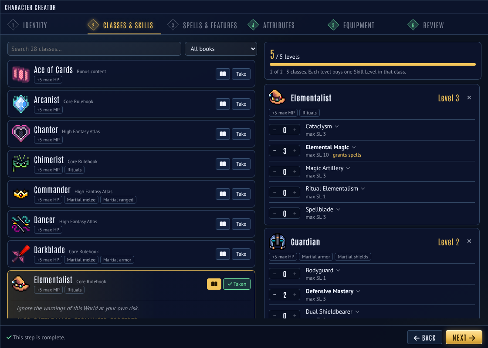
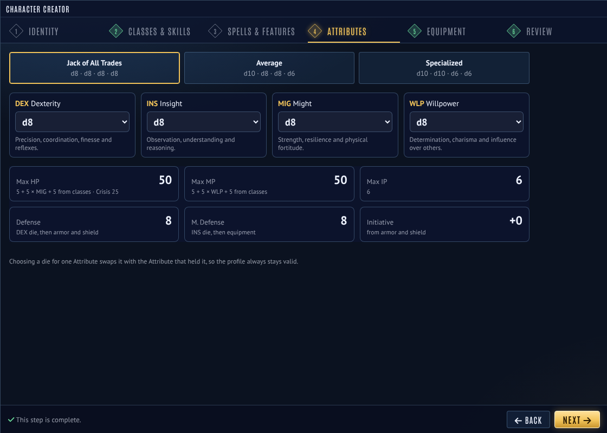

# Fabula Ultima Character Creator

A step-by-step character creation wizard for the Project FU system on Foundry VTT v13.

| | |
|---|---|
|  |  |
| Classes & Skills | Attributes, with live HP, MP, IP and defenses |

## Install
In Foundry: **Add-on Modules → Install Module**, paste this Manifest URL and click Install:
`https://github.com/EclipseGS27/fu-character-creator/releases/latest/download/module.json`

Then enable **Fabula Ultima Character Creator** in your world. (Manual install: unzip the release into `Data/modules/` so you get `Data/modules/fu-character-creator/module.json`.)

Requires the Project FU system 4.14 or later on Foundry v13 (4.16.3 is the latest v13 release).

## Opening it
- **Actors sidebar:** the **Character Creator** button makes a brand-new character.
- **Character sheet header:** an empty character (no classes yet) shows **Character Creator** in its header menu and fills in that actor. Use this for players who aren't allowed to create actors: make a blank character, give them ownership, and let them run the wizard on it.
- **Macro:** `game.modules.get('fu-character-creator').api.open()` or `.open(actor)`.

## Steps
1. **Identity:** name, portrait, Identity, Theme, Origin.
2. **Classes & Skills:** take 2–3 classes and spend 5 levels on their Skills (max SL enforced).
3. **Spells & Features:** spells for Elemental, Entropic and Spiritual Magic; arcana, dances, symbols, therioforms, psychic gifts, magiseeds, keys and tones, gadget types, vehicle frames and modules.
4. **Attributes:** Jack of All Trades, Average or Specialized, with live HP, MP, IP, Defense, Magic Defense and Initiative.
5. **Equipment:** spend the 500 z budget on gear your classes let you use (tick "Show all" to see martial gear you can't equip), then choose what to equip.
6. **Review:** create the character, or apply to the chosen actor.

The wizard has the same look as Fabula Ultima Battle UI: navy glass panels, the battle menu's tab bar with the steps in diamonds, gold for what you've picked. It ships its own fonts (Antonio and PT Sans, SIL Open Font License, see `fonts/`), so it looks the same without the Battle UI.

Classes, Skills, spells, class features and equipment are all read from your Item compendiums, so homebrew in world or module compendiums shows up automatically.

## Settings
Starting zenit, rolling 2d6 × 10 savings, rare equipment in the shop, starting class features from other books, filling in the advancement tracker, letting players open the creator, and compendiums to ignore.

## Optional rules (all off by default)
Each one is its own toggle in the module settings.
- **Starting Bonds** (Core p.220): one Bond with one feeling, written to the sheet.
- **Higher HP** (Core p.168): +10 maximum HP.
- **Custom Weapons** (High Fantasy p.106): a builder tab in the Equipment step, including transforming weapons. Cost, martial status and stats are worked out for you.
- **Quirks**: pick from the 37 Quirks across the three Atlases (name and page shown) or write your own, then type the rules text in. No two characters in the world can share one.
- **Camp Activities** (Natural Fantasy p.130): pick two; each comes with an editable summary.
- **Zero Powers** (High Fantasy p.124): pick a trigger and an effect (editable summaries), plus the extra choices some need. Triggers and effects already used by other characters are blocked. Creates the 6-section Zero Clock.
- **Awakened Power**: only the effect is chosen at creation.

Quirks, Camp Activities and Zero Powers also need the matching rule switched on in Project FU's own Optional Rules settings (they are on by default there). The creator tells the GM if one is off.

## Install
In Foundry: Add-on Modules → Install Module → paste this Manifest URL:
`https://github.com/EclipseGS27/fu-character-creator/releases/latest/download/module.json`
Requires Foundry v13 and the Project FU system.
